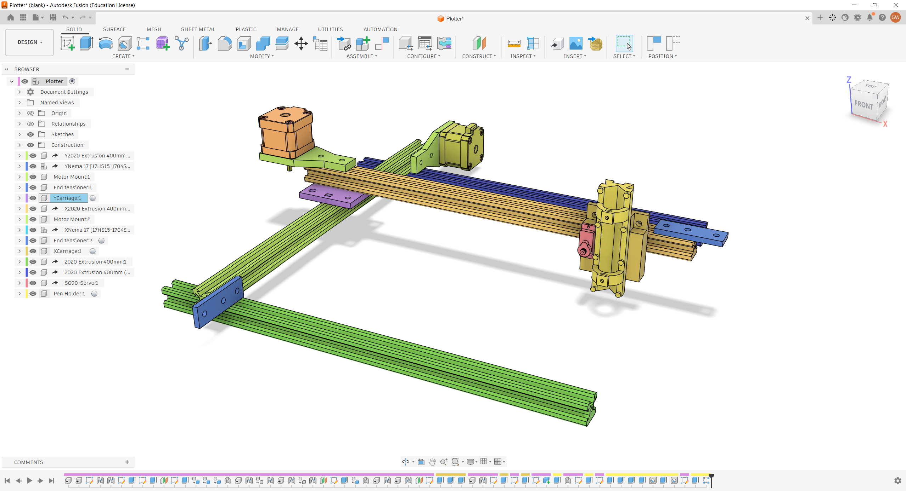

# Plotter

This repo contains the CAD files and BOM for a custom Plotter.

It is designed to plot on an A4 sized area, and pack as many features in, that a $100 budget would allow.

It works by moving a pen up and down, and moving the pen around in space. More detail can be found by reading through JOURNAL.md (My journal of my actions).

## CAD

Is only 5 unique pieces, with 2 of them being reusable across the axes.

- 2x End tensioner - Holds an idler at the end of the extrusion to loop the belt around
- 2x Motor Mount - A piece to screw into the frame and the steppers
- YCarriage - Lets the X axis move freely along the Y axis travel distance
- XCarriage - the part that meshes with the gantry and the pen holder
- Pen holder - the sliding part that holds the pen

## Parts

Uses 2020 extrusion, as both cheap and highly rigid.

Initially went with an ESP32 CNC shield, but have since switched to a Arduino based one for lower costs.

BOM and parts list

